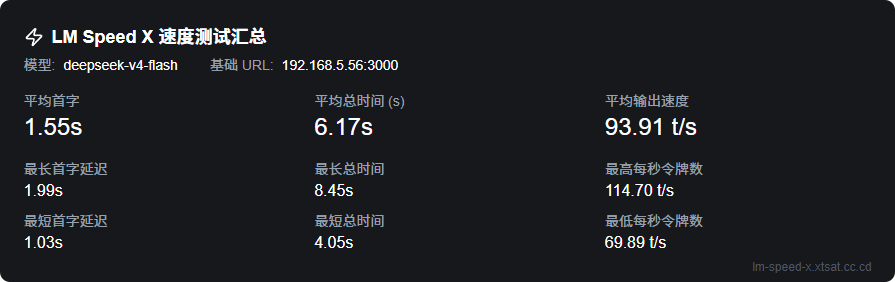
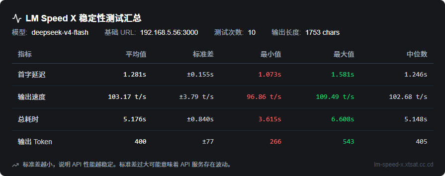
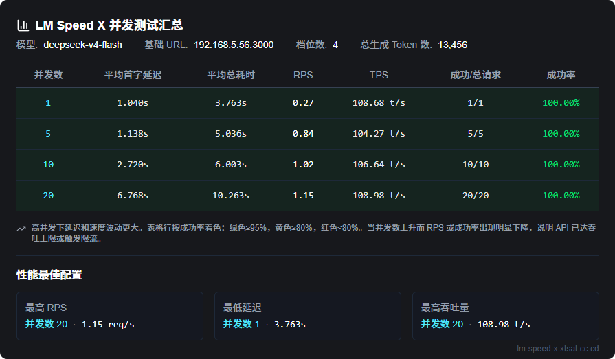
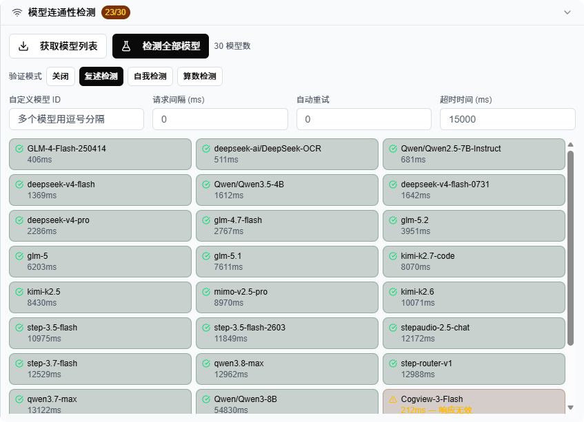
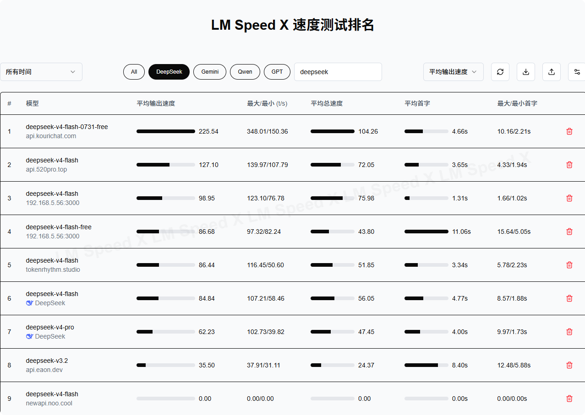

[中文](README_zh.md) | English

# LM Speed - Simple LLM Speed Analysis Tool

Portal: <https://lm-speed-x.xtsat.cc.cd>

Provides precise and reliable OpenAI API performance testing solutions for AI application developers. Through multi-dimensional real-time data analysis, it helps users quickly identify performance bottlenecks and optimize model calling strategies. It also offers an intuitive ranking feature, allowing users to easily compare and select the most suitable models and service providers.

## Features

- ⚡ **Real-time Speed Testing**: Test any OpenAI-compatible API (DeepSeek, SiliconFlow, Tencent Cloud, etc.) with your own `baseUrl`, `apiKey` and `modelId`. Five built-in prompts run through streaming with live progress, measuring first token latency, tokens per second (TPoS) and total response time.
- 🔧 **Automatic API URL Fixing**: scheme-less addresses get `http(s)://` auto-completed (http for private/CGNAT hosts); pasted full endpoints (`/chat/completions`, `/models`) are stripped back to the base address; and if `baseUrl` is missing the `/v1` suffix, the address is requested as-is first with `/v1` appended automatically when it fails. Browser-direct and server-proxy modes share the same logic, and the corrected URL is written back into the input. Auto-completion can be turned off in Extra Settings, after which the address is used exactly as typed.
- 📊 **Stability Testing**: Run configurable iterations (default 10) and get a complete statistical profile — mean, median, standard deviation, variance, min and max for latency, TPoS, output tokens and total time.
- 🚦 **Concurrency Stress Testing**: Test with multiple concurrency levels (e.g. 1 / 5 / 10 / 20), measuring success rate, RPS, average latency, p99 latency and average TPoS per level, and automatically recommending the best-performing configuration.
- 🛜 **Connectivity Checking**: Batch-verify model reachability before testing — including latency, retries, tier restrictions and content validity — so you can fix configuration issues upfront. Results can be filtered by status (success / warning / failed) or shown all at once (all by default), and the current filtered selection can be copied with one click.
- 🧠 **Model Authenticity Verification**: Detect disguised proxy models that swap real reasoning models for generic AI. Four built-in checks: PONG response detection, self-identification check, arithmetic reasoning verification, and image recognition verification.
- 🏆 **Ranking & Comparison**: All local test results are aggregated into a leaderboard with time-range filters, model/provider quick badges, custom search, metric-based sorting (TPoS / latency), and fully customizable table columns.
- 📤 **Data Import & Export**: Export rankings as JSON or save test reports as PNG images with one click; import JSON data back to merge results.
- 🔗 **Quick Start via URL**: Pre-fill the test form with `baseUrl`, `apiKey` and `modelId` URL parameters, or generate a shareable auto-test link — no manual form filling required.
- 🖥️ **LAN / Private API Support**: Local, intranet and tunnel addresses (including the `100.64.0.0/10` range) switch to browser-direct mode automatically, streaming straight from the browser past server-side proxy restrictions; after you pick an address, a notice in the bottom-right corner reports the current mode and offers one-click enabling when the address uses a custom port.
- 🔗 **One Connection Setup for All Three Tests**: Speed, stability and concurrency read the same URL, key, model, direct-connect switch and custom headers, with identical request timeouts and failure rules; stability and concurrency advance progress per completed run, show the elapsed wait time, and flag each failed run in red with its reason instead of stalling silently.
- ☁️ **Cloudflare Protection Bypass**: Automatically detect Cloudflare challenge pages when fetching model lists. Integrated manual verification dialog with embedded panel and popup window support — complete the challenge once, then model listing switches to browser-direct fetch.
- 🌐 **Bilingual & Local-First**: Full Chinese and English UI, no backend database required — all test results are stored in your browser's localStorage.
- 🌗 **Dark Mode**: Theme switcher in the header (Light / Dark / Follow system) — follows your system appearance by default, or pin your preference manually.
- 📲 **PWA Offline Support**: Install LM Speed X as an app (desktop / home screen) — the install entry is provided by the browser (address-bar install icon or the install item in the browser menu). Static assets are cached locally, so you can still open the app and browse past test results offline. Speed tests themselves always run in real time over the network.

## Comparison with the Original

LM Speed X is a fork of the original [nexmoe/lm-speed](https://github.com/nexmoe/lm-speed) project. Both share the same core speed-testing experience; LM Speed X focuses on a simpler deployment model — it ships as a single web page with no database dependency, making it lighter and easier to deploy:

| Feature | LM Speed (Original) | LM Speed X |
|---|---|---|
| Real-time speed testing (first-token latency / TPoS) | ✅ | ✅ |
| URL parameter quick start | ✅ | ✅ (adds `autoTest`) |
| Leaderboard | ✅ | ✅ (local data, filterable/sortable) |
| Bilingual UI | ✅ | ✅ |
| Stability testing (multi-round statistics) | — | ✅ |
| Concurrency stress testing (multi-level) | — | ✅ |
| Connectivity check (batch model reachability) | — | ✅ |
| Model authenticity verification | — | ✅ |
| Custom request headers | — | ✅ |
| Data import / export (JSON) | — | ✅ |
| Report export as PNG image | — | ✅ |
| Shareable quick-test link | — | ✅ |
| LAN / private API direct testing | — | ✅ |
| Cloudflare challenge manual bypass | — | ✅ |
| Dark mode (light / dark / follow system) | — | ✅ |
| PWA offline support (installable app) | — | ✅ |
| Database dependency | Requires a database | **None** — single-page deployment, more lightweight |
| Changelog page | — | ✅ |

## Screenshots

### Speed Test



### Stability Test



### Concurrency Test



### Connectivity Check & Model Verification



### Ranking



## More

### Quick Start

#### Manual Build & Deployment

1. Clone the repository

```bash
git clone https://github.com/XTsat/LM-Speed-X.git
cd LM-Speed-X
```

2. Install dependencies

```bash
pnpm install
```

3. Build the project

```bash
pnpm build
```

4. Start the service

```bash
pnpm start
```

The app runs at `http://localhost:3000` by default.

> **For development**, run `pnpm dev` instead — it starts the dev server with hot reload.
>
> **No configuration required**: the project has no database or external services, so no environment variables are needed — clone, install, build and start.

### URL Parameters Usage

LM Speed supports quick test initiation through URL parameters without manual form filling:

```
https://lm-speed-x.xtsat.cc.cd/?baseUrl=YOUR_BASE_URL&apiKey=YOUR_API_KEY&modelId=YOUR_MODEL_ID
```

Parameter Description:

- `baseUrl`: The base URL of the API service, e.g., `https://api.deepseek.com/v1`
- `apiKey`: Your API key
- `modelId`: The model ID to test
- `autoTest`: Set to `true` to start the test automatically after the page loads

Example:

```
https://lm-speed-x.xtsat.cc.cd/zh-CN?baseUrl=https://api.deepseek.com/v1&apiKey=sk-xxx&modelId=deepseek-chat&autoTest=true
```

Notes:

1. For security reasons, it's recommended not to pass API keys directly in URLs, but rather use the form for manual input
2. If the URL contains special characters, make sure to URL encode them

### Tech Stack

- **Frontend**:
  - Next.js 16
  - React 19
  - TypeScript
  - TailwindCSS
  - Radix UI Components
  - SWR for data fetching
  - next-intl for internationalization
  - next-themes for dark mode

- **Backend**:
  - Next.js API Routes
  - OpenAI SDK
  - tiktoken for token counting

- **Development**:
  - ESLint
  - TypeScript

- **Deployment**:
  - Single-page deployment (`pnpm build && pnpm start`)
  - Docker

> **No database required**: Test results are stored in the browser's localStorage, so the app runs without any backend database.

### Contributing

Issues and Pull Requests are welcome! Before submitting a PR, please ensure:

1. Code follows project coding standards (see [AGENTS.md](AGENTS.md))
2. Necessary tests are added
3. Related documentation is updated

### License

This project is licensed under the MIT License - see the [LICENSE](LICENSE) file for details
